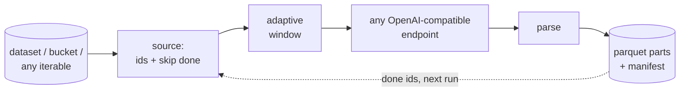
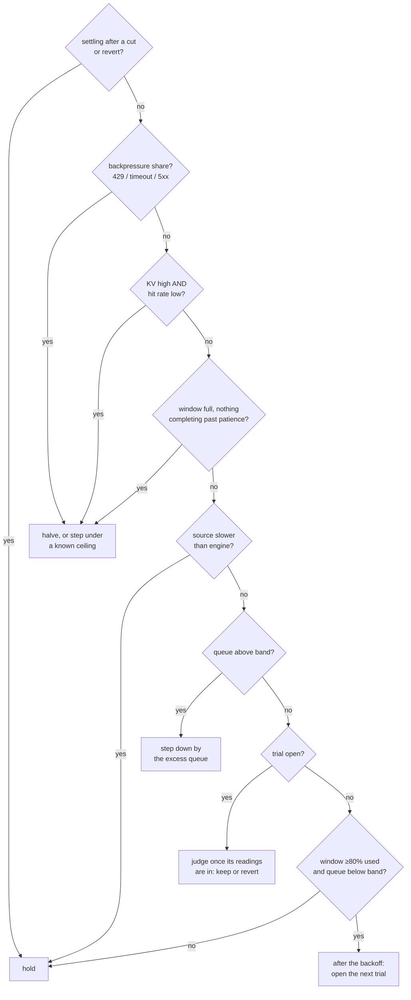

# Design

saturate exists for one loop: **data → model → nicer data** — run every row of a
dataset (or every file in a bucket) through a model and get a dataset back. This page
gives the high-level shape first, then how it is currently implemented. (Comparisons: [why.md](why.md) · on-disk
format: [../CONTRACT.md](../CONTRACT.md) · benchmark numbers:
[../spikes/RESULTS.md](../spikes/RESULTS.md).)

## The shape

Three pieces:

- **a row source** — any iterable of `(id, row)`; helpers exist for Hub datasets and
  buckets, but nothing requires them
- **an adaptive client** — keeps the endpoint busy without overloading it, by adjusting
  the number of in-flight requests at runtime
- **a storage contract** — the output is append-only parquet plus a manifest, so it is
  itself a dataset, and resume works by reading it back



The endpoint is anything that speaks the OpenAI HTTP API — vLLM, SGLang, llama.cpp,
TEI, an Inference Endpoint, a colleague's server. The library can boot a server for you
(`Engine`, a convenience) but never requires it: launch whatever you want, pass its URL.

Progress and resume live entirely in the output directory. A coordinator or UI can
watch a run by reading storage; it never needs to talk to the running process.

## The life of one row

```
source (any iterable / dataset_rows / bucket_rows)
  → id derivation (yours, or content-hash)          source.py
  → skip_done: anti-join against existing_ids()      source.py   ← resume happens HERE
  → admission: wait for a window slot                window.py
  → to_request(row) → HTTP POST (+retry ladder,      transport.py
      circuit breaker)
  → parse(row, response) → success or error record   core.py
  → buffered append → parquet part + manifest        sink.py
      sidecar (flush_every rows or the flush age)
```

Failures become durable *error rows* (never gaps); a re-run skips done ids exactly and
can retry errored ones (`retry_errors=True`). A later success record for a previously
errored id is called healing; readers let the success win.

## How it is currently implemented

### Modules

| module | role |
|---|---|
| `controller.py` | pure `decide(obs, limit) -> new_limit`: `Fixed(n)` or `Auto` (below) |
| `window.py` | asyncio admission gate whose limit the controller adjusts at runtime |
| `signals.py` | `SignalSource`: engine `/metrics` scrape (vLLM/SGLang/llama.cpp/TRT-LLM dialects, TEI queue-depth only) or none |
| `transport.py` | typed `Request` (json ⊕ multipart), retry ladder, circuit breaker |
| `core.py` | `AdaptiveLimiter` (slot/observe) → `AdaptiveClient` (+HTTP) → `through()` (stream of `Done` results — id, row, output, error, token usage) |
| `source.py` | `stream` (lazy normalize, content-hash ids), `skip_done` (anti-join + dedup), `shard_of` / `shard_select` (fan-out by a hash of the id) |
| `sources.py` | HF-native inputs (`[hf]` extra, lazy): `dataset_rows` (streaming Hub datasets), `bucket_rows` (raw objects by fsspec glob, bounded prefetch) |
| `sink.py` | Sink protocol: `ParquetSink` (full contract), `FileSink`; `drain`, `read_output` |
| `engine.py` | optional server lifecycle: boot templates, readiness gate, process-group kill |
| `telemetry.py` | per-tick records (CONTRACT §6) + run-end advisor |
| `__init__.py` | `pump()` = the composition of the above; `Stats`; agent-mode stdout contract |

### The controller (`Auto`)

Terms used below:

- **tick** — the controller runs on a ~2-second cadence; each tick it sees an `Obs`
  snapshot and returns the new window limit.
- **gauges** — engine-reported queue metrics scraped from `/metrics`: `waiting`
  (queued requests), `kv` (KV-cache utilization, 0–1), `hits` (prefix-cache hit
  rate). No gauges = **blind mode** (successes, errors/timeouts and delivered throughput only).
- **band** — the target range for the engine's `waiting` queue:
  `[max(1, target_waiting//4), target_waiting*2]` (default target 8 → band [2, 16]). Small
  and positive: the engine always has work, never a runaway backlog.
- **delivered throughput** — tokens/sec actually completed this tick; the primary
  signal. Gauges speed decisions up; throughput decides them.

**The search is a hill climber.** Holding a window, `Auto` measures its throughput (tokens/s,
or completions/s when tokens are not reported). Then it tries one move, a *trial*: the window
times the next factor of `MOVES` (×2, ×4, ×1.5, ×1.25, ×⅞, then over again). Once the trial
window's own readings have arrived (two latencies at that window, by Little's law, and three
ticks), its throughput is compared with the reading just before the move. A gain of 5% keeps
a wider window and starts `MOVES` over at ×2, so while each doubling pays it keeps doubling
(slow-start). A narrower window is kept unless throughput fell 5%, and a run of moves down is
judged against the reading where the run began. Anything else reverts, moves on to the next
factor, and doubles the wait before the next trial (1, 2, 4 … 32 evidence windows): a plateau
is retried rarely but never given up on. The ×4 move crosses a flat stretch that a doubling
cannot see past (SGLang's from 32 to 64); ×⅞ trims a window that overshot the engine's cap.
The same search runs with or without gauges: gauges feed the cuts below, and no trial opens
while the engine's queue stands at or above the band's low end.

Per tick, the first rule that applies wins and names itself as the tick's `reason` (telemetry
§6); `Stats.cut_reasons` counts the `cut:*` ones. Each rule is a sans-IO function
(it changes nothing but the jitter's `auto.rng`) in `saturate/controller.py`'s `RULES`, built from
`when(condition, action)`, over a frozen `State` whose phase is `Steady`, `Trial` or
`Settling`:



| reason | when | action |
|---|---|---|
| `hold:cooldown` | after a cut or revert: at least max(2 ticks, the last latency) (3 ticks when unknown), longer while the oldest request in flight predates the change, capped at the stall patience | hold; the old window's completions are not evidence |
| `cut:bp` | backpressure (429 / timeout / 5xx) on at least `bp_frac` of this tick's outcomes | halve and remember the window as a ceiling (growth stops ⅛ under it); at a ceiling met before, step under it instead. A ceiling is released after 300 s, because a provider's limit can rise; the first move past a released ceiling goes at most ⅛ past it |
| `cut:kv` | a preemption this tick, where the engine counts them (vLLM); else KV ≥ 0.9 AND prefix-hit rate < 0.5 or absent | halve — a full cache without preemptions is a busy engine (a large model runs there); high KV with healthy hits is cache reuse |
| `cut:stall` | window full and nothing completed for max(3 ticks, 3× latency); once per episode | halve — a wedged engine reads as an empty queue because nothing new is admitted |
| `hold:input_bound` | the source, not the engine, starves admission | hold; starved ticks are not evidence |
| `cut:queue` | queue above band (not before the first completion ever) | step down by the excess queue: at least `step`, at most half the window |
| `hold:kept` / `revert` | a trial's readings are in: kept on a gain (up) or no loss (down), else reverted | a kept move up restarts `MOVES`; a revert advances it and doubles the backoff |
| `hold` | window under 80% used, or a queue at or above the band's low end | hold |
| `hold:ack` | waiting for an evidence window (`limit` completions and two throughput samples), or for a trial to settle | hold |
| `hold:plateau` | waiting out the backoff between trials | hold |
| `hold:jitter` | the backoff is out, after a failed trial (backoff > 1): a random 0–4 more ticks on which the trial is due, drawn once per trial; other holds do not count | hold — clients sharing one endpoint fall out of step, and a hold they all see (a shared queue in band) does not put them back in step |
| `trial:up` / `trial:down` | the next move opens | move the window; judged later |
| `hold:ceiling` / `hold:floor` | a move would cross `max_limit` or a backpressure ceiling / `min_limit`, or a cut is already at `min_limit` | skip to the next move; a cut arms nothing |

A cut during a trial counts as a failed trial: the window goes no higher than where the trial
began (except a queue cut, which steps by what the gauge shows). Latency is the p50 of successful
attempts only — retries, backoff, breaker waits and
poison rows are excluded — and waits are integrated in seconds from the measured tick.
Trial jitter follows BBR's probe timing (a fixed base plus a uniform random wait, none during
Startup) and the additive jitter of stamina and tenacity. Without it, clients that share one
endpoint (sharded Jobs, or a team on one server) open their trials on the same tick, all see the
shared queue or the shared 429s, and all cut at once: a sawtooth. `Auto(seed=...)` fixes the
schedule (tests); by default each Auto draws its own. Blind clients sharing one engine (no
gauges, no 429s) remain a known gap: each judges its own throughput, a larger share of a fixed
total reads as a gain, and all grow to `max_limit` (a strict xfail in tests/test_controller_slow.py
pins it). Set `max_limit`, or expose the engine's /metrics.

`bench/controller_sim.py` scores any version of the controller against simulated engines
(tests/sim_engine.py). On random engines (a Hypothesis property) it reaches at least 75% of the
best fixed window: past a flat stretch that starts below the initial window, a gain just over
`improve` can read as flat, and the climber stays below it.

Before the first request, `AdaptiveClient` reads the engine's capacity once
(`signals.read_capacity`: SGLang `/v1/loads` or `/get_server_info` `max_running_requests`,
llama.cpp `/props` `total_slots`, TEI `/info` `max_concurrent_requests`; vLLM reports none).
Unless the caller set `initial`, `Auto` starts there (`Auto.begin`, once per run, from the
caller's unchanged configuration): above it by min(capacity, 2 × target_waiting) for an engine
that queues the rest, so a waiting request refills a free slot; exactly there, and never above
it, for TEI, which rejects the rest with 429s. The sources are asked at once, with 2 s
timeouts, and each is read by its engine's own response shape.

`Fixed(n)` bypasses all of it. Defaults: `Auto(target_waiting=8, initial=None (the engine's
capacity, else 64),
max_limit=512, step=8)`; cap `max_limit` (~128) for vision workloads — in-flight
images live in host RAM.

### Seams

- **Transport** — a protocol; HTTP is the shipped implementation. An in-process
  vLLM/SGLang transport is the planned second one (high-rate, short-output regime).
  Proven bring-your-own: a binary-audio TTS transport was written against the
  documented surface without modifying the package (RESULTS.md, TTS probe).
- **SignalSource** — `/metrics` scrape or none; the controller only ever sees a plain
  `Obs` dict. The dialect table matches both metric-name spellings per engine because
  the k8s Gateway API Inference Extension (GAIE) protocol fixes gauge *semantics* but
  not their names (see [why.md §7](why.md)). Dialects may be partial: TEI publishes
  queue depth (`te_queue_size`) and nothing else — no running gauge, no KV — so the
  controller runs the queue-band branches and skips the KV ones.
- **Sink** — one invariant: *an id returned by `existing_ids()` implies its record is
  durable; an id absent implies re-processing is safe.* `ParquetSink` carries the full
  CONTRACT; `FileSink` (one file per row, filesystem as manifest) is the second
  implementation; bring your own.
- **AdaptiveLimiter** — `slot()/observe(outcome)`: a drop-in replacement for a fixed
  semaphore in hosts that keep their own transport and IO (datatrove-shaped stacks).

### Invariants (tested)

Error rows, not lost rows · exactly-once admission per id (across runs via
manifest-first exact resume; within runs via dedup) · reserved columns `id`, `error`
always win over parse output · `error` is always string-typed · schema-invalid
responses are never marked success · the breaker can pause but never strand (waiters
always released; a server that stays down ends the run with an error) · stdout in
agent mode is exactly one JSON line.

### Known bounds (documented, not hidden)

Resume/dedup id-sets are in-memory (~10M rows comfortable; shard-scoped done-sets are
the planned fix beyond). Binary response routes (TTS audio) are not supported by the
built-in transport — use `AdaptiveLimiter` with your own transport. vLLM
pooling-model serving (embeddings) processes one batch per request, so embeddings
scale by fan-out, not by window. Frequent flushes to `hf://datasets/…` sinks mean
frequent commits — prefer buckets while a fan-out run is hot, publish to a dataset
repo at the end.
